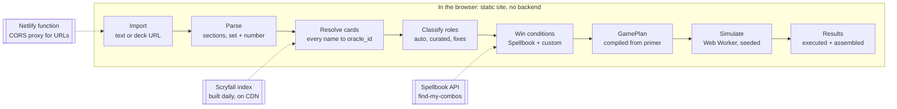

# Goldfish Tester — Implementation Plan

Nov 27, 2026 · Miko Castillo

## Overview

The app is a free goldfish tester for any Commander deck. It measures how fast the deck can execute its win when nobody interacts. It grows out of the Vivi Goldfish Simulator: the same seeded engine and kill-turn histogram, generalised so any decklist and any game plan can drive it.

**Scope: pure goldfish.** There is no opponent and no interaction. Counterspells and removal sit in hand as dead cards, which shows what those slots cost in speed. The app reports two numbers per game:

- **Executed turn**, the headline: the first turn the deck has the pieces *and* the mana to win.
- **Assembled turn**, supporting context: the first turn all pieces of a win condition are present. The gap between the two shows whether the deck is short on pieces or short on mana.

**Decisions made**

| Area | Decision |
| --- | --- |
| Hosting | Static app with no backend. Free to run and ships in a playground environment |
| Card data | A Scryfall bulk-data index built daily. The live API is only a fallback for misses |
| Card identity | Every card is keyed by `oracle_id`, so reflavored and Universes Beyond printings collapse to one card |
| Combos | Detected by Commander Spellbook. Each can be counted, ignored, or replaced by custom win conditions |
| Import | Pasted text, plus URL adapters for deck sites that allow it |
| Unknown cards | Flagged by cause, fixable by the user, fixes saved per `oracle_id` |
| Piloting | A primer, written through a guided form, compiles into a `GamePlan` that drives the engine |
| Sharing | The full setup is stored in the URL, so a shared link reproduces the same results |

## Architecture

Everything runs in the browser; only data comes from outside.



The whole pipeline runs client-side, so hosting stays free and a playground visit can't overload anything. Only three things are outside the browser, all of them data sources: the Scryfall index, rebuilt daily by a GitHub Action from Scryfall's bulk files (which have no rate limits) and cached in IndexedDB; a Netlify function that proxies URL imports; and Commander Spellbook's `find-my-combos`. Live Scryfall calls happen only for cards the index misses.

## Importing decks

Every import route ends in the same parser, so pasted text is the path that always works and the others are conveniences.

**Text parser.** It accepts the common export shapes:

- `1 Sol Ring` and `1x Sol Ring`
- Moxfield and Archidekt lines with printing info: `1 Sol Ring (CMR) 472 *F*`. Keep the set code and collector number, because they are the most reliable lookup for reflavored printings.
- Section headers such as `Commander`, `Deck`, `Sideboard` and `// Commander`. The commander goes to the command zone; sideboard and maybe-board cards are dropped.
- Blank lines, comments and foil or tag markers are ignored.

**URL import, in three tiers:**

1. **Adapters** for sites with public deck JSON, starting with Archidekt. A small Netlify function proxies the request to get around CORS, within the free tier.
2. **Graceful failure** for sites that block other sites. Moxfield does this, so its link shows: "Moxfield doesn't allow imports. Use Export → Plain Text and paste it here."
3. **Paste** as the universal fallback.

Each adapter returns the same shape: a list of `{ qty, name, set?, collectorNumber?, section }` lines, plus an optional primer text when the site provides one.

## Card resolution and roles

Scryfall answers which card a line refers to; the role registry answers how the simulator plays it. They stay separate.

**Resolution order**

1. Set + collector number, when the line has them.
2. An exact match on any name in the local index: oracle name, `printed_name` or `flavor_name`.
3. Live `/cards/named?fuzzy=` for misses, queued at 2 requests per second with 429 handling.

**Roles, in three layers**

- **Automatic from card data.** `type_line` marks lands, `produced_mana` on an artifact marks rocks, and `cmc` gives the cost. Oracle text heuristics guess the rest: "draw a card" means a cantrip, "search your library" means a tutor, "add {X}" means ramp. These are marked as guesses.
- **Curated registry.** A hand-written role per `oracle_id` for cards that need real behaviour, such as Brainstorm, Jeska's Will or Windfall. This is where today's `DB` table goes.
- **User fixes.** Saved in localStorage per `oracle_id`, so a fix carries over to every deck that card appears in.

**Problem flags**

| Flag | Cause | Fix in the UI | Blocks a run? |
| --- | --- | --- | --- |
| Not found | A typo, or a card newer than the index | Fuzzy suggestions, pick one | Yes, until fixed or removed |
| Ambiguous | One name matches several cards | Choose between them | Yes |
| Auto-guessed | The heuristic picked a role | Confirm or change | No |
| Unmodelled | No role, so the card is treated as a blank | Role picker | No |

A deck-level check also warns when the deck isn't 100 cards or the commander is missing.

## Win conditions

Win conditions are data rather than code: one list replaces the hard-coded `COMBOS` closures and the branches of `checkWin()`.

**Sources**

- **Commander Spellbook.** After resolution, the deck is sent to `find-my-combos`. It returns combos fully in the deck and combos one card away. Each one becomes a `WinCondition`. Results are cached by a hash of the deck.
- **Custom.** User-written conditions for wins Spellbook doesn't list: Grapeshot for exact lethal, a commander damage race, or Thassa's Oracle with a library-size check.

**Three states per combo**

- **Counts as a win**, the default.
- **Ignored**: the pieces stay in the deck, but assembling them doesn't end the game. This covers "no infinites" playgroups.
- **Custom**: written or edited by the user.

When a combo is ignored, tutors and dig logic must also stop prioritising its pieces. Otherwise the pilot keeps fetching pieces for a win it isn't allowed to take.

```ts
type WinCondition = {
  id: string;
  label: string;                          // "Isochron Scepter + Dramatic Reversal"
  source: 'spellbook' | 'custom';
  state: 'counts' | 'ignored';
  pieces: { oracleId: string; zone: 'hand' | 'battlefield' | 'command' }[];
  manaNeeded: number;                     // to execute once all pieces are present
  requires?: Condition[];                 // e.g. commander on battlefield, 2+ rock mana
};
```

Check Spellbook's Swagger docs for how a combo records each piece's required zone and the mana it needs. Fields the API doesn't provide are filled in by the user when they review the combo.

## Primer and GamePlan

The primer is what the user writes; the `GamePlan` is what the engine runs. The simulator never reads prose directly, so the same seed always gives the same result.

**Guided primer form (required core).** Each question maps to a field:

| Question | Field |
| --- | --- |
| What makes an opening hand keepable? | `mulligan` |
| When do you cast your commander? | `commander.castWhen` |
| What does the deck do on turns 1 to 3? | the first `priorities` |
| How do you win, and what's the backup? | the win conditions, prefilled from Spellbook |
| What should dig spells and tutors look for? | `dig` and `tutor` priorities |

**Never blank.** Once the deck resolves, a plan is drafted automatically from card roles (ramp count, cantrip density) and Spellbook win lines. The user corrects a reasonable draft instead of starting from nothing, so playground visitors can run a deck within seconds.

**Optional LLM import.** A freeform notes box, or a primer that came with a URL import, can be compiled into form values by a model using the user's own API key. The output is checked against a zod schema and shown for review before it is used. It is compiled once and stored, never run per simulation.

```ts
type GamePlan = {
  targetTurn: number;                          // colours the histogram
  mulligan: { minLands: number; maxLands: number; mustSee?: Role[] };
  commander: { castWhen: 'asap' | 'afterRamp'; engine?: EngineHook[] };
  priorities: PriorityRule[];                  // ordered; the first legal rule acts
  winConditions: WinCondition[];
};

type PriorityRule =
  | { do: 'cast'; role: Role; when?: Condition }
  | { do: 'tutor'; for: 'missingPiece' | Role }
  | { do: 'dig'; prefer: Role[] };
```

Because interaction never matters in a goldfish, there is no `holdBack`: the pilot always uses all its mana.

## Simulation engine

The engine is a pure TypeScript module with no DOM access. It runs inside a Web Worker and is driven by events, so commanders and cards plug in as data.

**Events and hooks.** The engine emits `upkeep`, `draw`, `landPlayed`, `spellCast` and `creatureEnters`. Engine pieces subscribe to them:

```ts
type EngineHook = {
  on: 'spellCast' | 'landPlayed' | 'upkeep' | 'creatureEnters';
  filter?: { noncreature?: boolean; type?: string };
  effects: Effect[];   // addCounter, damageEachOpponent, draw(n), addMana(n) ...
};
```

Vivi becomes `on spellCast (noncreature): add a counter, damage each opponent 1, draw 3 per Curiosity effect`. Rhystic Study, Mystic Remora and The One Ring become upkeep or draw hooks instead of special fields on `bf`.

**Pilot loop, each turn**

1. Upkeep and draw triggers, then the draw step (none on turn 1 on the play).
2. Play a land.
3. Repeat until no rule applies (with a step cap): check win conditions, then take the first legal `PriorityRule`.
4. End-of-turn actions, such as flash creatures.

**Assembled vs executed.** `checkWin()` returns both results:

```ts
type WinCheck = { assembled: WinCondition[]; executable: WinCondition | null };
```

The engine records the first turn each happened, and logs an event for each. When assembly is blocked by mana, the log notes the shortfall, such as "needs 4 mana, have 3."

**Kept from the Vivi sim:** the `mulberry32` seeded RNG, the mulligan loop, and the card-selection `score()`, which is generalised to read the plan's `dig` priorities and missing combo pieces.

## UI and results

The executed turn is the main number everywhere; the assembled turn explains it.

**Results view**

- The histogram plots executed turns, with turns before the target in rose, the target turn in gold, later turns in blue, and "no win by turn 10" in grey.
- A faint ghost segment on each bar shows games that assembled on that turn but executed later.
- Stat tiles: median executed turn as the main figure, the share won by the target turn, and a small line such as "assembled ~0.6 turns earlier on average."
- "Which line won" bars, one per win condition.

**Sample game playback**

- Plays back turn by turn instead of appearing all at once, with a skip control.
- Assembly is a quiet beat that names the shortfall. Execution is the climax: a gold line, and the log scrolls to it.
- Respects `prefers-reduced-motion`.

**Playground affordances**

- The URL hash holds the deck, plan, combo states, card fixes and seed, compressed with lz-string. A shared link reproduces the same histogram.
- The Vivi deck loads as the demo, so a visitor can press Run before pasting anything.
- The Scryfall index loads lazily in the background while the demo results show.

Styling builds on the Final Fantasy menu look from the Vivi sim, implemented with AsterMotion components.

## Build phases

Each phase ends at a gate you can test before moving on.

```mermaid
flowchart TD
  p1["<b>1 · Port the engine</b><br/>Move sim() into a pure TypeScript module with unchanged behaviour, plus Vitest snapshot tests.<br/>Run it in a Web Worker behind the current UI."]
  g1{{"Gate: seed 1126 with the Vivi list reproduces today's histogram exactly"}}
  p2["<b>2 · Card data and resolution</b><br/>A daily GitHub Action builds the slim index; text parser; resolver with the live fuzzy fallback.<br/>Problem flags UI, with fixes saved per oracle_id."]
  g2{{"Gate: the Vivi and Zur lists resolve with no Not found flags"}}
  p3["<b>3 · General engine</b><br/>Event hooks, GamePlan and WinCondition types; checkWin returns assembled and executed.<br/>Re-express Vivi as data: a commander hook, curated roles and its win conditions."]
  g3{{"Gate: data-driven Vivi matches phase 1's median kill turn within noise"}}
  p4["<b>4 · Combos and primer</b><br/>Spellbook combos with counts, ignored and custom states; tutors skip ignored pieces.<br/>Guided primer form, the auto-drafted plan and the role auto-classifier."]
  g4{{"Gate: the Zur deck runs from an auto-drafted plan with no hand-written code"}}
  p5["<b>5 · Results UI and playground launch</b><br/>Histogram with assembled ghost segments, stat tiles and turn-by-turn sample game playback.<br/>URL-hash sharing, the Vivi demo deck, the Archidekt adapter and the Moxfield paste fallback."]
  g5{{"Gate: a shared link opened in a fresh browser shows the same results"}}
  later["Later: LLM primer import with the user's own key, more URL adapters, Convex if accounts are wanted"]

  p1 --> g1 --> p2 --> g2 --> p3 --> g3 --> p4 --> g4 --> p5 --> g5 -.-> later
```



Phase 1 comes first so that every later change can be checked against a known-good baseline. Phases 2 and 3 can overlap, because resolution and the engine meet only at the `oracle_id`-keyed role registry.

## Open questions

- [ ] Does the `GamePlan` schema cover Zur? Draft the Zur deck's plan in it and note what doesn't fit.
- [ ] Which Vivi piloting decisions would a stranger get wrong? That list becomes the guided form's questions.
- [ ] Does Spellbook's combo data give each piece's zone and the mana needed in machine-readable form? Check the Swagger docs before building the `WinCondition` mapping.
- [ ] Does Spellbook's API allow browser CORS calls, or does it need the Netlify proxy too?
- [ ] Which deck sites besides Archidekt expose public deck JSON?
- [ ] How large is the slim index once gzipped? Under about 5 MB keeps the first load acceptable.
- [ ] What is the default turn cap? It's 10 today; slower decks may need 12.
- [ ] Should the turn order (on the play or on the draw) stay a toggle, or should runs report both?
